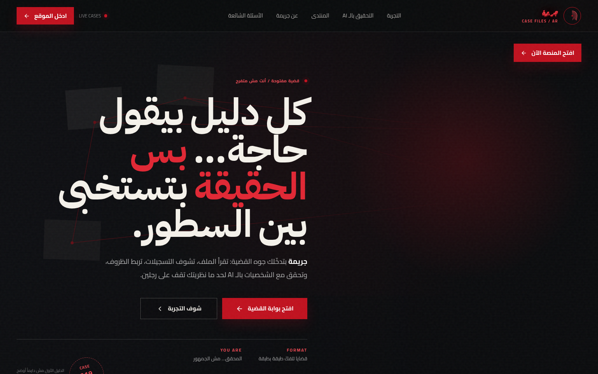

# 🕵️ Gareema

**An interactive Arabic detective game — read the case, interrogate suspects with AI, and pin the truth.**

## 📖 Overview

Gareema is an online crime-investigation game built entirely in Arabic. You open a case file, study the evidence and recordings, then interrogate suspects and witnesses — each one answers through AI, staying in character — until your theory stands on solid ground. Around the game lives a whole community: a players' forum and a magazine that keeps the universe breathing between cases.

## ✨ Features

- 🗂️ **Complete case files** — evidence, recordings and witness lists
- 🤖 **AI-powered interrogations** where every character stays in character
- 🧩 **Investigation loop** — collect clues, form a theory, verify it
- 💬 **Community forum** and an in-universe magazine
- 🎬 **Cinematic noir art direction**, fully in Arabic

## 🧱 Tech Stack

`Next.js` · `AI` · `Interactive` · `Realtime` · `Arabic RTL`

## 🌐 Live Product

**Try it now:** [https://gareema.vercel.app](https://gareema.vercel.app)

---

Built by **[Hamza Talal](https://github.com/{USERNAME})** — 15-year-old full-stack developer from Egypt

